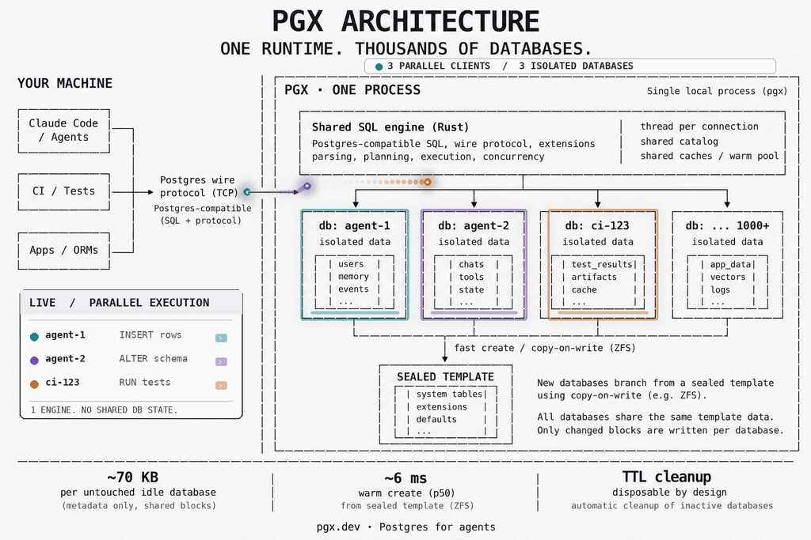
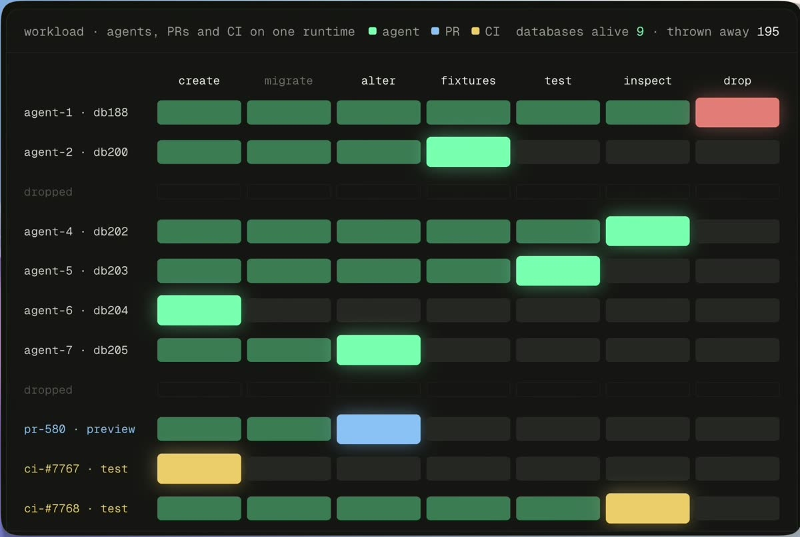
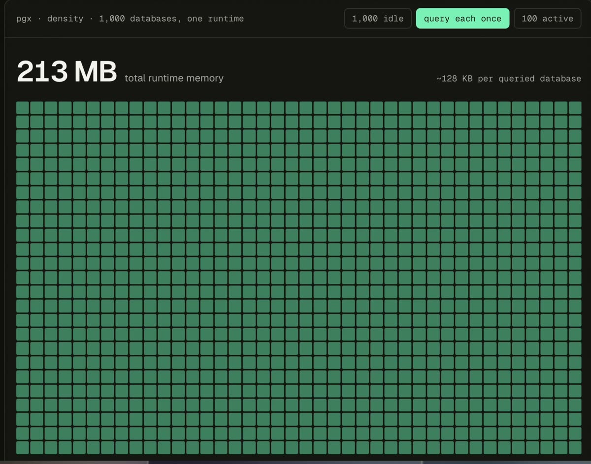
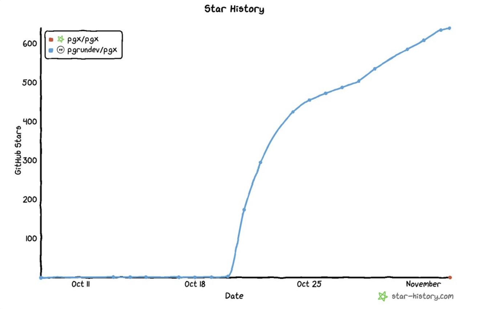

<h1 align="center">PGX</h1>

<p align="center">
  <strong>Every AI agent gets its own Postgres.</strong><br>
  One runtime. Thousands of Postgres databases.
</p>

<p align="center">
  
  
  
  <a href="LICENSE"></a>
</p>

<p align="center">
  <a href="#quickstart">Quickstart</a> ·
  <a href="#every-ai-agent-gets-its-own-postgres">Agents</a> ·
  <a href="#why-pgx">Why PGX</a> ·
  <a href="#benchmarks">Benchmarks</a> ·
  <a href="#architecture">Architecture</a> ·
  <a href="#status">Status</a> ·
  <a href="#documentation">Docs</a>
</p>

<p align="center">
  <strong>Install one Skill. Your coding agent handles the database.</strong><br>
  No Docker required · Native Mac &amp; Linux · Automatic cleanup
</p>

```text
# Claude Code: install inside a session (native plugin, lightweight repository)
/plugin marketplace add pgrundev/pgx-plugin
/plugin install pgx@pgx-plugin
```

```bash
# Any agent host (Claude Code, Cursor, Codex): the Agent Skills CLI
npx skills add pgrundev/pgx --skill pgx

# Manual PGX installation
npx pgxdb@latest
```

<!-- skills.sh badge: add [](https://skills.sh/pgrundev/pgx) once https://skills.sh/pgrundev/pgx lists the skill -->

<p align="center">
  <sub>Open source · Free · v0.1.3 · For disposable databases, not production data</sub>
</p>

PGX is a database runtime for short-lived Postgres databases: agent
sandboxes, CI and per-PR databases, test and preview environments. One PGX
process holds many isolated databases. Each costs tens of kilobytes of
memory while idle, is created in milliseconds from a sealed template, and
is backed, on a copy-on-write storage backend such as ZFS, by a clone
that starts at a few megabytes whatever the template's size (on a
filesystem without block cloning a branch is a full copy).

PGX speaks the Postgres wire protocol and SQL dialect. Rails, Django,
Prisma, SQLAlchemy and node-postgres run their full migrate → test →
schema-change lifecycles on it unchanged.

PGX is the database engine behind PGRun branches.

> A database should be cheap enough to allocate like an object, not
> provision like a server.

## Why PGX

<p align="center">
  
</p>

Agent workflows, test suites, CI jobs and preview environments create
databases constantly and throw them away minutes or hours later. Giving
each one its own PostgreSQL server costs a process, tens of megabytes and
a cold start every time. PostgreSQL is built to keep one database running
for years; PGX is built to create one in milliseconds, use it briefly and
delete it.

```text
1 PostgreSQL server → 1 database
1 PGX runtime       → hundreds or thousands of isolated databases
```

Immutable state is shared. Each database pays mainly for what makes it
different, and follows a lifecycle built for being thrown away:

```text
sealed template
      ↓
   mint database        milliseconds, copy-on-write
      ↓
agent / CI / test       minutes or hours
      ↓
    discard             dropped a grace period after the last session
```

On Linux, ZFS block cloning lets a branch share every unchanged block with
its template, so a branch of a 10 GB database is ready in under a second
and starts at about 14 MB of its own storage. Every agent, every pull
request and every test run can have its own real Postgres-compatible
database.

## Disposable by design

Postgres was built to run for years. An AI agent needs a database for two
minutes: create → migrate → test → destroy. Multiply that by 1,000 agents
running in parallel and you do not need 1,000 Postgres servers. You need
one runtime holding thousands of isolated, disposable databases, each
dropped the moment its agent, pull request or CI job is done.

<p align="center">
  <picture><source srcset="docs/pgx/img/disposable.gif" type="image/gif"></picture>
</p>

## Benchmarks

Measured on a 4 vCPU / 8 GB / $8.50-a-month VPS with ZFS block cloning. The
load generator ran on the same CPUs, so these are architecture numbers,
not capacity limits.

```text
~6.2 ms      warm database mint, p50 (cold copy-on-write clone: 74 ms)
~70 KB       memory per untouched idle database (~128 KB once queried)
128–155 MB   one runtime holding 1,000 idle databases; 213 MB after all were used
111 MB       runtime memory after 30,000 create → use → drop lifecycles
~674 ms      copy-on-write branch of a 10 GB template, ~13.6 MB new storage
0            result differences on PostgreSQL's src/test/regress (219 / 231 byte-exact vs PG 18.6)
36 / 36      framework runs: Rails 8.1, Django 5.2, Prisma 6, SQLAlchemy 2, node-postgres
```

PGX is not trying to beat Postgres on single queries. Short statements are
about 0.05–0.15 ms slower than PostgreSQL 18, large single-threaded scans
1.5–2.2× slower, COPY and 4-client throughput equal; whole framework
lifecycles take 0–15 % longer. Transactional behaviour follows PostgreSQL,
including transactional DDL, savepoints and temporary tables.

These describe measured configurations and workloads, not a claim that
PGX is faster than PostgreSQL in general. The regression figure is
PostgreSQL's own test suite on one platform under the regress profile,
not a compatibility percentage for arbitrary SQL. Every figure has a
script and a committed raw result. The tables, the isolation results and
how to reproduce them: [`docs/pgx/benchmarks.md`](docs/pgx/benchmarks.md).
The full report: [`docs/pgx/linux-results.md`](docs/pgx/linux-results.md).

## Architecture

The central idea: **share everything immutable, pay for divergence.** It
applies to memory and to storage alike.

One process, one shared SQL engine, and one isolated database per client:
each agent, CI job or app connects over the ordinary Postgres wire protocol
and gets a database branched copy-on-write from a sealed template. The
engine, catalog, caches and warm pool are shared; only each database's own
changed blocks are written. Nothing is shared between databases.

### 1,000 databases, one PGX process

One idle PostgreSQL server: 16.6 MB. One idle PGX database: about 70 KB.
Databases are isolated by name, roles and limits inside one process with a
thread per connection. A database costs its catalog caches, not a server:
databases cloned from the same template share identical relation-cache
entries, and idle databases are skipped by autovacuum. Measured on a
4 vCPU / 8 GB VM:

```text
one idle PostgreSQL 18 server        16.6 MB
one idle PGX database               ~70 KB     (~128 KB once it has been queried)
1,000 idle PGX databases          128–155 MB   in one process
1,000 databases, each queried once    213 MB
1,000 databases, 100 active           283 MB
```

[Benchmarks →](docs/pgx/benchmarks.md)

### 1,000 databases on a MacBook in 46.6 seconds

Not a cluster, not Docker, not the cloud: PGX on a 16 GB M1 Pro, cloning a
31 MB app database 1,000 times with `pgx clone`. All 1,000 clones in
46.6 s, 41 ms median per clone, 0 errors, and the engine idles at 20 MB
RSS with all 1,000 present. Under load it grows with the sessions, not the
databases: 340 MB at 100 concurrent readers, back to 20 MB when they
disconnect.

<p align="center">
  <a href="docs/pgx/benchmarks.md"><picture><source srcset="docs/pgx/img/arch-density.gif" type="image/gif"></picture></a>
</p>

### Mint-on-connect

Connecting to `<prefix><template>__<token>` creates that database from a
sealed template and connects you to it, in about 6 ms from a warm pool of
pre-created spares and 74 ms cold. A janitor drops it a grace period after
its last session ends, unless it is pinned.

```text
psql -d tdb_tpl_app__agent42      # does not exist yet
                                  # → minted from tpl_app, 6.2 ms p50
psql -d tdb_tpl_app__agent43      # a second, isolated one
                                  # → 0 rows: it sees none of agent42's writes
   …last session ends…
                                  # → dropped after the grace period
```

[Sealing templates and minting by hand →](docs/pgx/local-dev/build-from-source.md#make-a-template-and-mint-databases)

### Copy-on-write storage

`file_copy_method = clone` turns database creation into ZFS block clones.
A branch shares every unchanged block with its template, so its cost grows
with divergence: a branch of a 10 GB template is ready in 674 ms and starts
at 13.6 MB of its own storage. On a filesystem without block cloning a
branch is a full copy.

```text
template (10 GB)
├── branch A → only changed blocks      674 ms, +13.6 MB
├── branch B → only changed blocks
└── branch C → only changed blocks

 1 GB template → 135 ms, +2.3 MB
 2 GB          → 198 ms, +3.7 MB
 5 GB          → 417 ms, +7.0 MB
10 GB          → 674 ms, +13.6 MB
```

[ZFS copy-on-write →](docs/pgx/zfs-cow.md)

### Limits at every level

Session, database and runtime memory limits inside the engine, connection
limits per database, and a Linux cgroup around the runtime. Memory-heavy
work fails with a PostgreSQL-style error (SQLSTATE 53200) instead of
taking the host down; the session stays usable and other databases see
0 errors. `pgrust_runtime_status()` returns the whole picture as JSON:
databases, sessions, memory against limits, warm-pool and mint counters.

```text
session  →  database / runtime  →  Linux cgroup

ERROR:  out of memory                         SQLSTATE 53200
HINT:   The session reached pgrust.session_memory_limit.
        (transaction aborted; session stays connected; other databases: 0 errors)

SELECT pgrust_runtime_status();
{"memory":{"rss_bytes":…,"session_limit_mb":256,"database_limit_mb":512,"runtime_limit_mb":3072},
 "connections":42,
 "databases":{"total":1003,"ephemeral":998,"spares":8,"pinned":2},
 "janitor":{"prefix":"tdb_","pool_size":8,"pending_mints":0}}
```

[Memory limits and the cgroup backstop →](docs/pgx/linux-limits.md)

### A branch per agent

The PGX Skill and `pgx agent` put the lifecycle on hooks: each Claude Code
session gets its own branch with `DATABASE_URL` already set, extended while
the agent works and dropped after it stops, and every subagent gets a
branch of its own. Two agents never see each other's changes, and your
PostgreSQL is only ever read.

```text
session start   →  pgx branch myapp <session>   DATABASE_URL set
  subagent      →  pgx branch myapp <subagent>  its own branch
  agent works   →  TTL extended
session end     →  branch dropped
```

[Agents →](docs/pgx/local-dev/agents.md)

## Status

PGX is at **v0.1.3**, an early release with known limitations listed in the
[release notes](https://github.com/pgrundev/pgx/releases/tag/v0.1.3). It
already powers PGX branches in [PGRun](https://pgrun.dev), which adds the
control plane around it: safe masked copies of a source database, sealed
templates, one branch per agent, PR or CI job, routing, access and
automatic expiry. The current focus is PostgreSQL and application
compatibility, concurrency semantics, lifecycle correctness, predictable
resource containment and real agent workloads. If PGX behaves differently
from PostgreSQL for a supported workload, we want a reproducible test case
(see Contributing).

**PGX v0.1 is for disposable databases:** agent, CI, PR, test and preview
databases built from sanitized copies of production. Use it where losing
a branch is acceptable. It is **not** a production primary, a system of
record, or an HA or PITR database:

- **Not crash-safe.** The PGX profile runs with `fsync = off`.
- **One process.** A runtime is one crash domain.
- **No C extensions.** Existing PostgreSQL C extensions cannot load; only
  the built-in contrib modules exist, pgvector among them. PL/Python,
  PL/Perl and PL/Tcl are not available.

Keep Postgres as the source of truth for data you can't afford to lose.
The full list is in [`docs/pgx/v0.1-readiness.md`](docs/pgx/v0.1-readiness.md).

## Quickstart

One command installs PGX, starts it, creates an `app` database and prints its
connection URL. No Docker, Rust or system PostgreSQL; the native distribution
is self-contained and relocatable.

```bash
npx pgxdb@latest
```

```console
PGX is ready.

  postgres://postgres:…@127.0.0.1:5432/app
```

Point `DATABASE_URL` at that URL. `npx pgxdb` with no arguments is `pgx run`;
every other `pgx` command works the same way through npx, and
`npm install -g pgxdb` puts `pgx` on your PATH for good:

```bash
pgx url app                      # its connection URL
pgx ls                           # databases, TTL, expiry, size
pgx branch app agent-001         # a disposable 2-hour branch for one agent
pgx clone app pr-123 --ttl 5m    # a 5-minute copy-on-write clone
pgx create scratch --ttl 2h      # a throwaway database, gone in 2 hours
pgx --json ls                    # machine-readable output for agents
pgx stop
```

Without Node, `curl -fsSL https://pgx.dev/install | sh` does the same
install. Supported: Apple silicon Macs and Linux (arm64, x86-64); Intel
Macs are not supported yet. Any PostgreSQL client or ORM works against
`pgx url <db>`.

Clones are copy-on-write on a backend with block cloning (such as ZFS), a
full copy elsewhere. `pgx branch` is `pgx clone` for agents: a 2-hour TTL by
default and the connection URL as the last line of output, so an agent can
be handed `DATABASE_URL="$(pgx branch myapp agent-1 | tail -1)"`. Databases
created without `--ttl` are permanent; a background supervisor drops each
temporary one shortly after its deadline and never touches permanent or
system databases ([`ttl.md`](docs/pgx/local-dev/ttl.md)).

The full CLI, install options, integrations (Rails, Node, Python, Go, psql),
storage model and troubleshooting are under
[`docs/pgx/local-dev/`](docs/pgx/local-dev/). Building the engine yourself,
running a bare runtime and minting from a sealed template by hand:
[`build-from-source.md`](docs/pgx/local-dev/build-from-source.md).

### Every AI agent gets its own Postgres

Install the Skill, then ask your agent. In Claude Code, from inside a session:

```text
/plugin marketplace add pgrundev/pgx-plugin
/plugin install pgx@pgx-plugin
/pgx:pgx Set up isolated Postgres databases for this project.
```

For Cursor, Codex or several hosts at once, the Agent Skills CLI installs the
same Skill into the project:

```bash
npx skills add pgrundev/pgx --skill pgx
```

> Use PGX to give this project isolated databases for coding agents. Set everything up.

The agent detects your database setup, installs PGX if needed, imports your
development database **schema-only** into a template (`pgx copy`), writes a
committed `.pgx.toml`, installs lifecycle hooks (`pgx agent setup`) and
proves a branch. From then on each session gets its own branch with
`DATABASE_URL` already set, extended while the agent works and removed after
it stops, and every subagent gets a branch of its own; two agents never see
each other's changes and your PostgreSQL is never written. Installing the
Skill executes nothing by itself: the agent does the setup when the Skill is
activated and your permissions allow it.

| Host | Automatic isolation | Status |
|---|---|---|
| Claude Code | yes, through hooks: one branch per session and one per subagent | verified live |
| Cursor | hooks installed; `pgx agent exec --` when `PGX_ISOLATION` is unset | env propagation pending live verification |
| Codex | `pgx agent exec -- codex` (Codex hooks cannot set environment) | wrapper verified |

Requires PGX 0.1.2 or newer; the Skill checks the installed version before it
does anything. [`pgrundev/pgx-plugin`](https://github.com/pgrundev/pgx-plugin)
holds only the plugin (about 110 KB, generated from this repository), so
the install takes seconds; adding this repository itself as the marketplace
works too but clones about 2 GB. The lifecycle, security rules and host
differences: [`agents.md`](docs/pgx/local-dev/agents.md),
[`claude-plugin.md`](docs/pgx/local-dev/claude-plugin.md); the Skill
itself: [`skills/pgx/SKILL.md`](skills/pgx/SKILL.md).

### One Git branch, one isolated Postgres

```bash
cd my-project
pgx git init                      # main database, first main snapshot, Git hooks
git switch -c feature/auth        # ✓ PGX database ready: feature/auth (cloned from main in ~40 ms)
pgx git exec -- bin/rails db:migrate
git switch main                   # main's database again; feature/auth keeps its migrations
pgx git sync                      # publish main's new schema as the next immutable snapshot
git switch -c feature/billing     # starts from the latest validated main snapshot
pgx git status
```

Plain `git switch` stays plain Git: the hooks create or reuse the branch's
copy-on-write database, worktrees get their own, main updates never replace
an existing branch database, and every AI agent session on a branch still
gets a private copy of that branch's database. A hook cannot change your
shell's environment, so commands run with `pgx git exec -- …`, or
`pgx git install-shell` refreshes `DATABASE_URL` at every prompt. Details:
[`git.md`](docs/pgx/local-dev/git.md).

### Watch every agent's database live

```bash
pgx top            # project → Git branch → session → subagent, live connections, TTLs, lifecycle
pgx top --demo     # try it without PGX: a simulated session with five agents
pgx agent activity --state testing --task "Implement OAuth"   # what an agent reports shows in TASK
```

Read-only and native (a Ratatui terminal UI); `pgx --json top --snapshot`
gives the same view as one JSON object. Details:
[`top.md`](docs/pgx/local-dev/top.md).

### Keep your Postgres, branch it in PGX (by hand)

The same thing without an agent. Copy PostgreSQL into PGX once, then give
every agent its own branch. The source is only read; PostgreSQL stays your
source of truth.

```bash
PGX_PORT=5433 npx pgxdb@latest                 # PGX beside PostgreSQL on 5432

# Import PostgreSQL once (pg_dump → pg_restore, read-only on the source)
pgx copy --from "$DATABASE_URL" --to myapp --schema-only

# Give each AI agent its own database (isolated, self-expiring after 2h)
pgx branch myapp agent-1
pgx branch myapp agent-2
pgx agent exec -- bin/rails test               # or: any command in a branch of its own
```

`--schema-only` copies the structure without the rows (migration bookkeeping
such as `schema_migrations` is kept). The copy needs `pg_dump`/`pg_restore`
on the machine, refuses sources that use extensions PGX does not ship
(PostGIS, TimescaleDB, …) and never overwrites an existing database.
Details, limitations and measurements: [`copy.md`](docs/pgx/local-dev/copy.md).

## Documentation

| Document | What's in it |
|---|---|
| [`benchmarks.md`](docs/pgx/benchmarks.md) | every benchmark table, isolation results, and how to reproduce them |
| [`linux-results.md`](docs/pgx/linux-results.md) | the full benchmark report |
| [`v0.1-baseline.md`](docs/pgx/v0.1-baseline.md) | the frozen v0.1 numbers and the build each came from |
| [`v0.1-readiness.md`](docs/pgx/v0.1-readiness.md) | what is ready, known limitations, approved use |
| [`compatibility-gate.md`](docs/pgx/compatibility-gate.md) | how to decide whether a database can run on PGX |
| [`local-dev/`](docs/pgx/local-dev/) | install, CLI, integrations, storage, TTL, troubleshooting |
| [`local-dev/build-from-source.md`](docs/pgx/local-dev/build-from-source.md) | build the engine, run a bare runtime, seal a template and mint databases by hand |
| [`local-dev/claude-plugin.md`](docs/pgx/local-dev/claude-plugin.md) | the PGX plugin for Claude Code and the lightweight `pgrundev/pgx-plugin` repository |
| [`local-dev/agents.md`](docs/pgx/local-dev/agents.md) | the PGX Skill and `pgx agent`: automatic per-session isolation for Claude Code, Cursor and Codex |
| [`local-dev/git.md`](docs/pgx/local-dev/git.md) | PGX Git: one database per Git branch and worktree, main snapshots, shell integration, agents |
| [`local-dev/copy.md`](docs/pgx/local-dev/copy.md) | `pgx copy`: import an existing PostgreSQL database and branch it per agent |
| [`local-dev/top.md`](docs/pgx/local-dev/top.md) | `pgx top`: a live, read-only terminal view of the runtime, its databases and every agent session; `pgx agent activity` task phases |
| [`pgrun-integration.md`](docs/pgx/pgrun-integration.md) | the host-agent API PGRun builds against |
| [`lifecycle-memory.md`](docs/pgx/lifecycle-memory.md), [`linux-churn.md`](docs/pgx/linux-churn.md) | memory under long churn, and what was fixed |
| [`zfs-cow.md`](docs/pgx/zfs-cow.md) | copy-on-write branch cost and the recordsize trade-off |
| [`linux-limits.md`](docs/pgx/linux-limits.md) | memory limits and the cgroup backstop |

## Contributing

PGX is early, and the most useful contribution is a concrete
compatibility case. If something works on PostgreSQL 18 and behaves
differently on PGX, open an issue with:

```text
PostgreSQL version
PGX version
minimal SQL reproduction
expected result
actual result
```

The areas where a case helps most: MVCC, locking, deadlocks, isolation
levels, transactional DDL, ORMs (Rails, Django, Prisma, SQLAlchemy),
schema migrations and client compatibility. Every real compatibility bug
becomes a permanent regression test.

<p align="center">
  <a href="https://star-history.com/#pgrundev/pgx&Date"></a>
</p>

## Origin

PGX is built on [pgrust](https://github.com/malisper/pgrust), a
PostgreSQL-compatible database written in Rust. We are grateful to the
pgrust project and its contributors for the foundation PGX builds on.
PGX narrows that foundation to one problem, high-density disposable
Postgres-compatible databases for agents and tests, and its own changes
concentrate on shared database state, lifecycle and churn, density,
memory containment, copy-on-write branching, fast minting and agent/test
compatibility.

## License

PGX is licensed under [AGPL-3.0](LICENSE). Portions derived from PostgreSQL
remain under the PostgreSQL License; see [`NOTICE`](NOTICE).

---

Production PostgreSQL is optimized to live for years. PGX is optimized to
live for minutes.

**One runtime. Thousands of isolated databases. Postgres for agents.**
